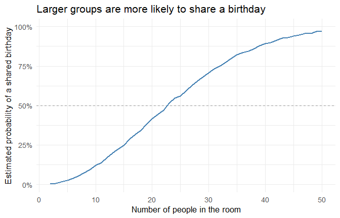
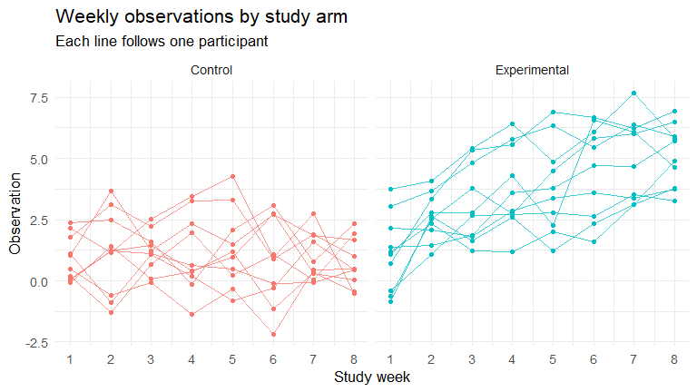
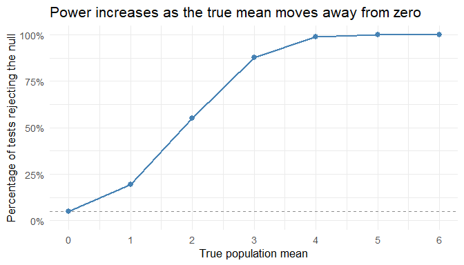
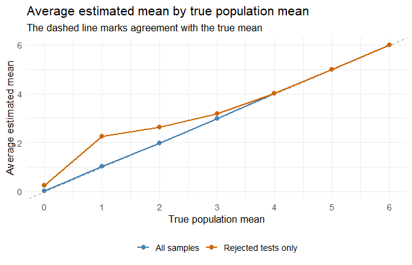

p8105_hw5_yl6375.Rmd
================
Yikai Lu
2026-11-13

\#Problem 1

``` r
library(tidyverse)
```

    ## ── Attaching core tidyverse packages ──────────────────────── tidyverse 2.0.0 ──
    ## ✔ dplyr     1.1.4     ✔ readr     2.1.5
    ## ✔ forcats   1.0.0     ✔ stringr   1.5.1
    ## ✔ ggplot2   4.0.3     ✔ tibble    3.2.1
    ## ✔ lubridate 1.9.3     ✔ tidyr     1.3.1
    ## ✔ purrr     1.0.2     
    ## ── Conflicts ────────────────────────────────────────── tidyverse_conflicts() ──
    ## ✖ dplyr::filter() masks stats::filter()
    ## ✖ dplyr::lag()    masks stats::lag()
    ## ℹ Use the conflicted package (<http://conflicted.r-lib.org/>) to force all conflicts to become errors

``` r
has_shared_birthday <- function(n) {
  birthdays <- sample.int(365, size = n, replace = TRUE)
  any(duplicated(birthdays))
}
```

``` r
#Estimate the probability for each group size
set.seed(8105)

birthday_results <- tibble(group_size = 2:50) |>
  mutate(
    probability = map_dbl(
      group_size,
      function(n) mean(replicate(10000, has_shared_birthday(n)))
    )
  )
```

``` r
ggplot(birthday_results, aes(x = group_size, y = probability)) +
  geom_hline(yintercept = 0.5, linetype = "dashed", color = "grey60") +
  geom_line(color = "steelblue", linewidth = 1) +
  scale_y_continuous(
    labels = scales::label_percent(accuracy = 1),
    limits = c(0, 1)
  ) +
  labs(
    title = "Larger groups are more likely to share a birthday",
    x = "Number of people in the room",
    y = "Estimated probability of a shared birthday"
  ) +
  theme_minimal(base_size = 13)
```

<!-- --> \#The
estimated probability of a shared birthday increased with group size.
The first group size for which at least half of the simulated rooms had
a match was 23. By the largest group size of 50 people, 97.3% of rooms
had at least one match. A shared birthday becomes more likely as the
group grows because each new person can match anyone already in the
room. In the largest group alone, there were 1225 possible pairs.

\#problem 2

``` r
library(tidyverse)
participant_files <- tibble(
  path = list.files(
    "data/longitudinal",
    pattern = "\\.csv$",
    full.names = TRUE
  )
)

stopifnot(nrow(participant_files) > 0)

participant_files <- participant_files |>
  mutate(
    file_name = basename(path),
    measurements = purrr::map(path, read_csv, show_col_types = FALSE)
  )

participant_files |>
  select(file_name, measurements) |>
  head()
```

    ## # A tibble: 6 × 2
    ##   file_name  measurements      
    ##   <chr>      <list>            
    ## 1 con_01.csv <spc_tbl_ [1 × 8]>
    ## 2 con_02.csv <spc_tbl_ [1 × 8]>
    ## 3 con_03.csv <spc_tbl_ [1 × 8]>
    ## 4 con_04.csv <spc_tbl_ [1 × 8]>
    ## 5 con_05.csv <spc_tbl_ [1 × 8]>
    ## 6 con_06.csv <spc_tbl_ [1 × 8]>

``` r
study_data <- participant_files |>
  mutate(participant = tools::file_path_sans_ext(file_name)) |>
  separate_wider_delim(
    participant,
    delim = "_",
    names = c("arm", "subject_id")
  ) |>
  mutate(arm = recode(arm, con = "Control", exp = "Experimental")) |>
  unnest(measurements) |>
  pivot_longer(
    cols = starts_with("week_"),
    names_to = "week",
    names_prefix = "week_",
    names_transform = list(week = as.integer),
    values_to = "observation"
  ) |>
  select(arm, subject_id, week, observation) |>
  arrange(arm, subject_id, week)

head(study_data, 8)
```

    ## # A tibble: 8 × 4
    ##   arm     subject_id  week observation
    ##   <chr>   <chr>      <int>       <dbl>
    ## 1 Control 01             1        0.2 
    ## 2 Control 01             2       -1.31
    ## 3 Control 01             3        0.66
    ## 4 Control 01             4        1.96
    ## 5 Control 01             5        0.23
    ## 6 Control 01             6        1.09
    ## 7 Control 01             7        0.05
    ## 8 Control 01             8        1.94

``` r
ggplot(
  study_data,
  aes(
    x = week,
    y = observation,
    group = interaction(arm, subject_id),
    color = arm
  )
) +
  geom_line(linewidth = 0.7, alpha = 0.75) +
  geom_point(size = 1.2) +
  facet_wrap(~ arm, nrow = 1) +
  scale_x_continuous(breaks = 1:8) +
  labs(
    title = "Weekly observations by study arm",
    subtitle = "Each line follows one participant",
    x = "Study week",
    y = "Observation"
  ) +
  theme_minimal(base_size = 13) +
  theme(legend.position = "none")
```

<!-- -->

\#The two arms had overlapping observations at the first week. Over
time, observations generally increased in the experimental arm, while
control participants fluctuated without a clear overall trend. The
average within-participant change from the first to the last week was
+3.98 units in the experimental arm and -0.17 units in the control arm.
By the final week, every experimental participant had a higher
observation than every control participant.

\#Problem 3

``` r
simulate_t_test <- function(true_mu) {
  x <- rnorm(n = 30, mean = true_mu, sd = 5)
  test <- t.test(x, mu = 0, alternative = "two.sided")

  tibble(
    estimate = unname(test$estimate),
    p_value = test$p.value
  )
}

set.seed(8105)

n_sim <- 5000
alpha <- 0.05

sim_results <- expand_grid(
  true_mu = 0:6,
  simulation = seq_len(n_sim)
) |>
  mutate(result = map(true_mu, simulate_t_test)) |>
  unnest(result) |>
  mutate(rejected = p_value < alpha)

power_summary <- sim_results |>
  group_by(true_mu) |>
  summarise(
    n_tests = n(),
    rejection_rate = mean(rejected),
    mean_all = mean(estimate),
    mean_rejected = mean(estimate[rejected]),
    .groups = "drop"
  )

power_summary
```

    ## # A tibble: 7 × 5
    ##   true_mu n_tests rejection_rate mean_all mean_rejected
    ##     <int>   <int>          <dbl>    <dbl>         <dbl>
    ## 1       0    5000         0.0486   0.0157         0.258
    ## 2       1    5000         0.195    1.02           2.26 
    ## 3       2    5000         0.55     1.99           2.62 
    ## 4       3    5000         0.879    2.98           3.19 
    ## 5       4    5000         0.991    4.00           4.02 
    ## 6       5    5000         0.999    4.99           5.00 
    ## 7       6    5000         1        5.99           5.99

``` r
ggplot(power_summary, aes(x = true_mu, y = rejection_rate)) +
  geom_hline(yintercept = alpha, linetype = "dashed", color = "grey55") +
  geom_line(linewidth = 0.9, color = "steelblue") +
  geom_point(size = 2.5, color = "steelblue") +
  scale_x_continuous(breaks = 0:6) +
  scale_y_continuous(labels = scales::label_percent(), limits = c(0, 1)) +
  labs(
    title = "Power increases as the true mean moves away from zero",
    x = "True population mean",
    y = "Percentage of tests rejecting the null"
  ) +
  theme_minimal(base_size = 13)
```

<!-- --> When the
true mean was zero, the test rejected the null in 4.86% of simulations,
close to the nominal significance level of 5%. As the true mean
increased from 1 to 3, estimated power rose from 19.5% to 87.9%. With
sample size and variability held fixed, larger differences from zero
were easier to detect.

``` r
power_summary |>
  select(true_mu, mean_all, mean_rejected) |>
  pivot_longer(
    cols = c(mean_all, mean_rejected),
    names_to = "samples",
    values_to = "average_estimate"
  ) |>
  ggplot(aes(x = true_mu, y = average_estimate, color = samples)) +
  geom_abline(slope = 1, intercept = 0, linetype = "dashed", color = "grey55") +
  geom_line(linewidth = 0.9) +
  geom_point(size = 2.5) +
  scale_color_manual(
    values = c(mean_all = "steelblue", mean_rejected = "darkorange3"),
    labels = c(mean_all = "All samples", mean_rejected = "Rejected tests only")
  ) +
  scale_x_continuous(breaks = 0:6) +
  labs(
    title = "Average estimated mean by true population mean",
    subtitle = "The dashed line marks agreement with the true mean",
    x = "True population mean",
    y = "Average estimated mean",
    color = NULL
  ) +
  theme_minimal(base_size = 13) +
  theme(legend.position = "bottom")
```

<!-- -->

Across all samples, the average estimated mean closely followed the true
mean. When the true mean was 1, the average estimate was 1.02 across all
samples and 2.26 among rejected tests. For a small positive effect,
samples whose means fluctuate upward are more likely to reach
significance, so selecting only significant results tends to
overestimate the effect. As the true mean increased, nearly all tests
rejected the null and the two averages converged. At a true mean of
zero, the two-sided test can reject in either direction, so the positive
average among rejected tests in this simulation reflects random
variation.
